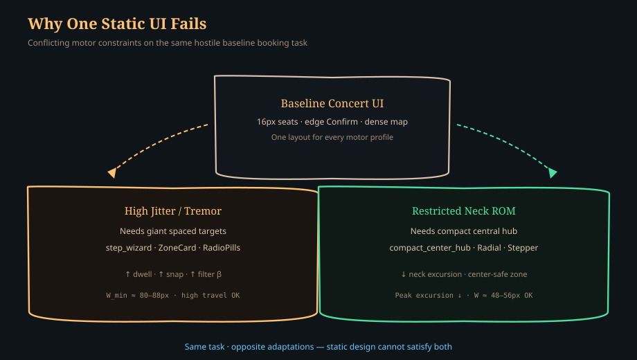
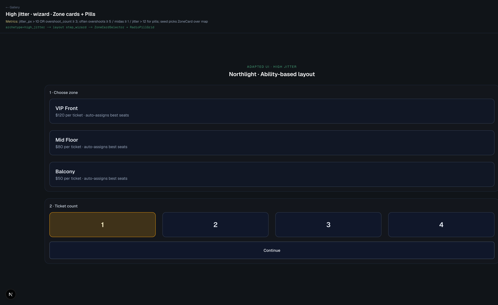
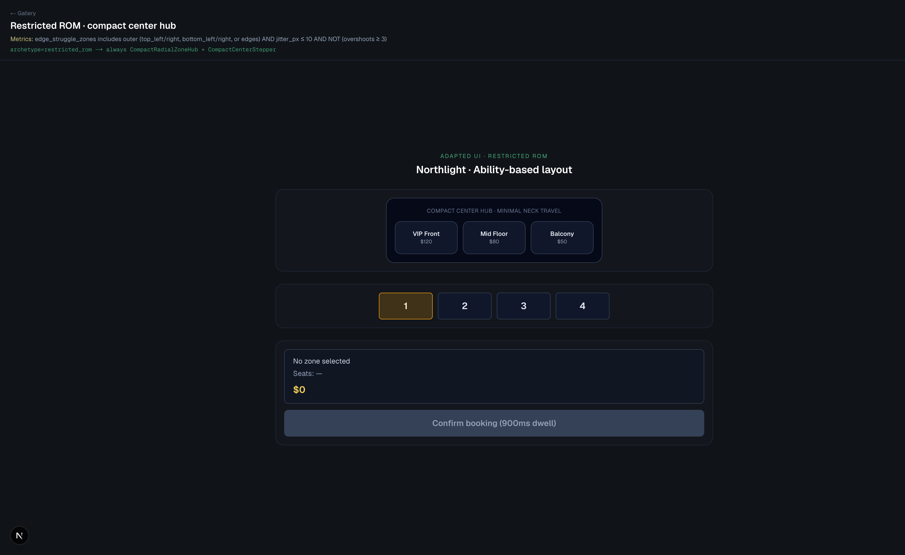
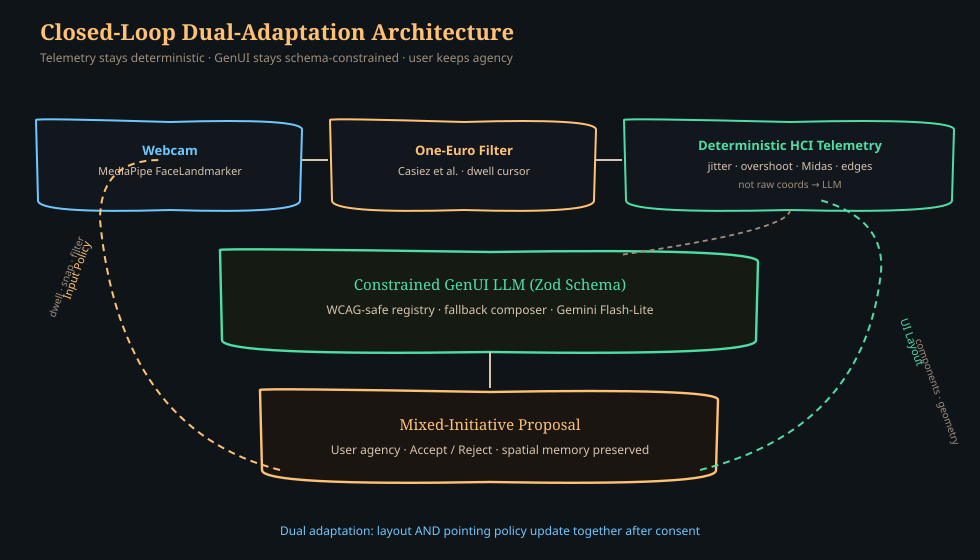
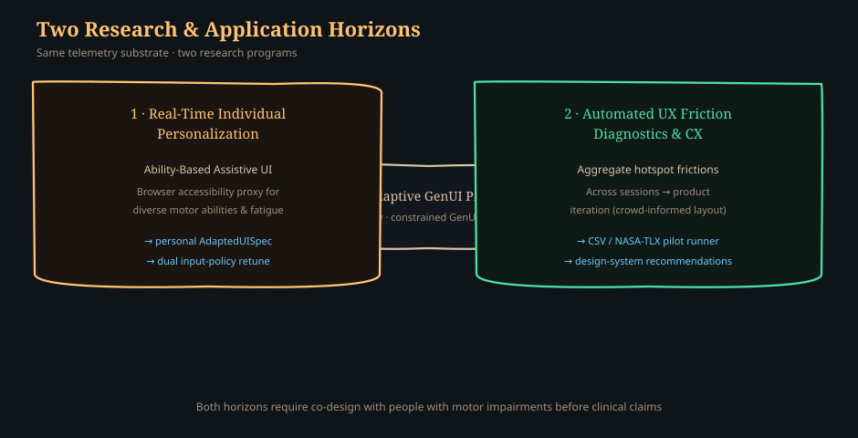
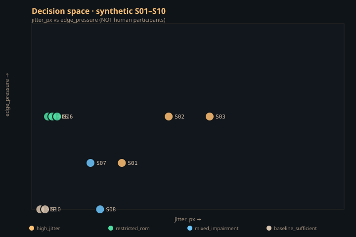
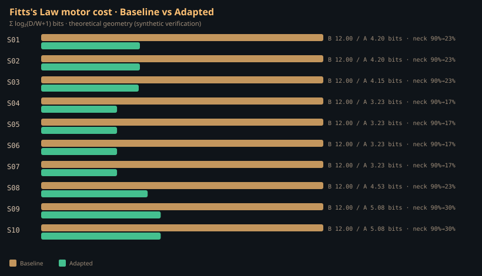
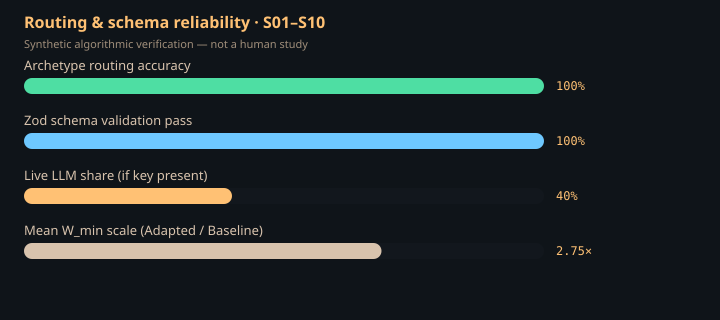

# Gaze-Adaptive Constrained Generative UI

**Research tagline:** Ability-based dual adaptation — when one static booking UI cannot satisfy both high-tremor and restricted-neck motor needs, the interface and the pointing policy must change together.

**Live demo:** https://kimiasmt.github.io/gaze-adaptive-ui/

### Quick links

| | |
|---|---|
| **Live demo** | https://kimiasmt.github.io/gaze-adaptive-ui/ |
| **Variant Gallery** | [/gallery](./src/app/gallery) · on demo: https://kimiasmt.github.io/gaze-adaptive-ui/gallery/ |
| **Gallery PDF** | [`docs/GenUI_Variant_Gallery_Report.pdf`](./docs/GenUI_Variant_Gallery_Report.pdf) |
| **SPEC** | [`SPEC.md`](./SPEC.md) |

---

## About This Prototype (Transparent Framing)

This is a **Research-through-Design prototype** built to materialize, test, and communicate a research direction in **Ability-Based Generative UI** and **hands-free accessibility**.

The author framed the HCI problem, defined telemetry metrics and accessibility constraints, and designed the evaluation methodology (guided task → mixed-initiative proposal → counterbalanced pilot runner).

---

## The Core HCI Problem (Why Static Design Fails)

A dense concert-booking baseline (16px seats, edge Confirm) creates **conflicting motor constraints**:

- **High jitter / tremor** needs larger, spaced targets and longer dwell — often a step wizard far from the edges.
- **Restricted neck ROM** needs a **compact central hub** so peak neck excursion stays low.

One static layout cannot optimize both. Intra-user neck fatigue can flip which constraint dominates mid-session.



---

## Visual Proof — Two Opposite Adaptations from One Baseline

| High Jitter → spaced wizard | Restricted ROM → compact hub |
|---|---|
|  |  |
| **Triggers:** high `jitter_px`, seat-map overshoots | **Triggers:** outer `edge_struggle_zones`, low jitter |
| **Layout:** `step_wizard` · `ZoneCardSelector` · `RadioPillGrid` | **Layout:** `compact_center_hub` · `CompactRadialZoneHub` · `CompactCenterStepper` |
| **Policy:** ↑ dwell, ↑ magnetic snap, stronger One-Euro | **Policy:** center-safe zone, shorter travel, moderate targets |

Dual adaptation means **layout/components** and **input policy** (dwell · snap · filter) update together after explicit user consent.

---

## System Architecture & Constrained GenUI



- **Deterministic telemetry** (not raw coordinates → LLM): jitter, overshoots, Midas-touch, path efficiency, and edge stalls are computed client-side so the model reasons over *friction*, not pixels.
- **Zod-constrained GenUI**: the LLM may only emit WCAG-safe components from a fixed registry; invalid JSON falls back to a rule-based composer.
- **Mixed-initiative consent**: proposals are shown before apply so spatial memory and user agency are preserved (Accept / Reject).

---

## Application Scope (Personalization & CX Diagnostics)



1. **Real-time individual personalization** — ability-based assistive UI as a browser accessibility proxy for diverse motor abilities and fatigue.
2. **Automated UX friction diagnostics** — aggregate hotspot frictions across sessions to inform product / CX iteration (crowd-informed layouts), without claiming crowd ≻ personal.

---

## 10-Profile Synthetic Verification & Theoretical Fitts's Law Evaluation

> **Label:** *Synthetic Algorithmic Verification & Theoretical Motor Cost Modeling* — **not** human-subject trials.  
> The in-app **Pilot Study** runner (`PilotStudyModal`: counterbalanced A/B, NASA-TLX, CSV export) is prepared for a follow-up human pilot.

Run locally:

```bash
npm run verify   # uses Bun to execute scripts/run-verification.ts
```

Artifacts land in [`docs/verification/`](./docs/verification/): `results.json`, `results.csv`, and three charts.

Metrics are produced **organically** by feeding synthetic trajectories through `TelemetryEngine` (no post-hoc metric overrides). The table reports both the deterministic **composer** archetype and the **final** adapted-spec archetype used for Fitts geometry.

### Summary table (latest `npm run verify` run)

| ID | Composer → Final | Jitter | Overshoots | Midas | Edge | Baseline Σ ID | Adapted Σ ID | Neck % B→A | Layout |
|----|------------------|--------|------------|-------|------|---------------|--------------|------------|--------|
| S01 | high_jitter → high_jitter | 8.08 | 9 | 0 | 1 | 12.00 | 4.20 | 90→23 | step_wizard |
| S02 | high_jitter → high_jitter | 12.28 | 15 | 1 | 2 | 12.00 | 4.20 | 90→23 | step_wizard |
| S03 | high_jitter → high_jitter | 15.95 | 18 | 1 | 2 | 12.00 | 4.15 | 90→23 | step_wizard |
| S04 | restricted_rom → restricted_rom | 1.46 | 0 | 0 | 2 | 12.00 | 3.23 | 90→17 | compact_center_hub |
| S05 | restricted_rom → restricted_rom | 1.85 | 0 | 0 | 2 | 12.00 | 3.23 | 90→17 | compact_center_hub |
| S06 | restricted_rom → restricted_rom | 2.28 | 0 | 0 | 2 | 12.00 | 3.23 | 90→17 | compact_center_hub |
| S07 | mixed_impairment → restricted_rom* | 5.27 | 6 | 3 | 1 | 12.00 | 3.23 | 90→17 | compact_center_hub |
| S08 | mixed_impairment → mixed_impairment | 6.13 | 6 | 4 | 0 | 12.00 | 4.53 | 90→23 | step_wizard |
| S09 | baseline_sufficient → baseline_sufficient | 0.77 | 0 | 0 | 0 | 12.00 | 5.08 | 90→30 | single_column_large |
| S10 | baseline_sufficient → baseline_sufficient | 1.20 | 0 | 0 | 0 | 12.00 | 5.08 | 90→30 | single_column_large |

\*S07: deterministic composer routed `mixed_impairment`; Live LLM emitted a valid `restricted_rom` spec (Zod OK) — both columns are reported transparently.

**Archetype routing accuracy (deterministic composer vs labeled synthetic kind): 100%** on S01–S10. Fitts cost uses Shannon $ID = \log_2(D/W + 1)$ on a fixed 1440×900 booking path.

**Live LLM / schema:** 4/10 profiles returned `Live LLM`; Zod validation pass **10/10** on the final `AdaptedUISpec` (fallback composer used when Gemini was unavailable or non-conforming).







---

## Grounded HCI Literature & Research Ethics

- **Wobbrock et al.** — *Ability-Based Design*: design for what people *can* do; adapt systems to abilities rather than forcing users to adapt.
- **Gajos et al.** — *SUPPLE*: automatic UI generation from user motor/vision models under preference and performance constraints.
- **Casiez et al. (CHI 2012)** — *1€ Filter*: adaptive low-pass smoothing for noisy interactive systems (implemented in `oneEuroFilter.ts`).

### Limitations & Ethics

Synthetic simulations and non-disabled pilot tests only establish **technical feasibility**. They **never** replace **co-design** with people with motor impairments (*Nothing About Us Without Us*). Claims about clinical benefit, diagnosis, or “better for disabled users” are out of scope for this prototype.

---

## Future Research Questions

1. How should **WebXR / spatial panels** re-express the same dual-adaptation loop when pointing is mid-air rather than head-gaze on a 2D viewport?
2. Can **longitudinal neck-fatigue models** predict mid-session ROM collapse and trigger proactive compact-hub proposals without false alarms?
3. What is a safe architecture for **client-side DOM transcoding** of arbitrary third-party sites under the same Zod-constrained GenUI + mixed-initiative consent model?

---

## Local Development & Deployment

### Requirements

- Node.js 20+ (Bun recommended for `npm run verify`)
- Chrome + laptop webcam for head-gaze
- [Google AI Studio](https://aistudio.google.com/apikey) key (optional; deterministic composer always works)

### Setup

```bash
npm install
cp .env.example .env.local
# set NEXT_PUBLIC_GEMINI_API_KEY=…
# leave NEXT_PUBLIC_BASE_PATH empty for local dev
npm run dev
```

Open [http://localhost:3000](http://localhost:3000).

### Usage

1. First load: **Enable webcam** or **Use mouse simulator**.
2. Interact → **Analyze Telemetry** (Live LLM via Gemini) or start the **guided task**.
3. Open **Variant Gallery** in the header (or `/gallery`).
4. Researcher drawer: perturbations (`Simulate Restricted Neck ROM`), pilot study, CSV export.

### Deploy — GitHub Pages

Static export (`output: "export"`). Live LLM calls Gemini from the browser.

1. Push to GitHub (public).
2. **Settings → Pages → Source: GitHub Actions**.
3. Add Actions secret `NEXT_PUBLIC_GEMINI_API_KEY`.
4. Restrict the key by HTTP referrer to your Pages origin + `http://localhost:3000/*`.
5. Push to `main` → **Deploy GitHub Pages** publishes  
   https://kimiasmt.github.io/gaze-adaptive-ui/ .

## License

MIT — research prototype.
